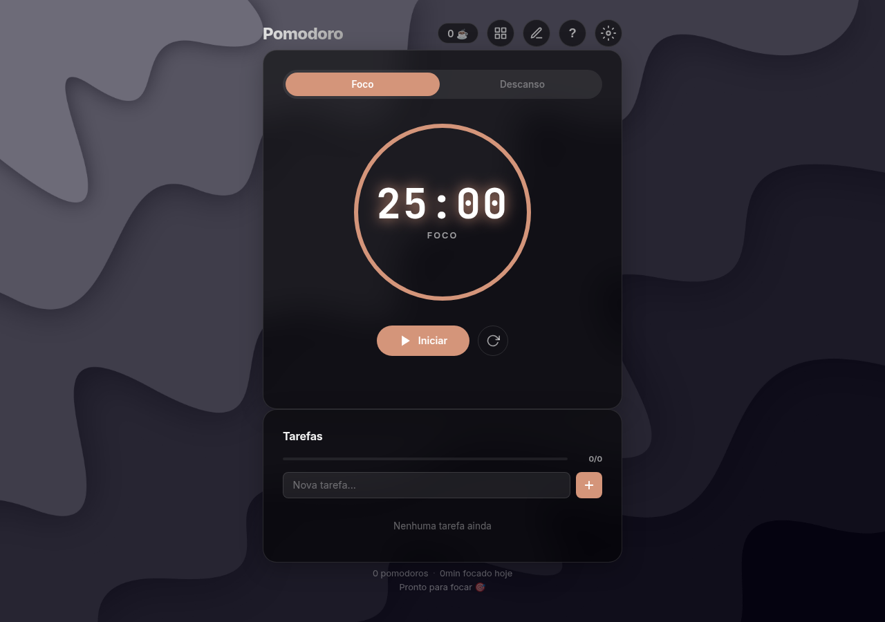

# Pomodoro 🍅

Timer de produtividade baseado na Técnica Pomodoro, feito em **HTML, CSS e JavaScript puro** — sem frameworks, sem build e sem servidor. Abre direto no navegador.



---

## ✨ Funcionalidades

- ⏱️ **Timer de foco e descanso** com anel de progresso
- ✅ **Tarefas** — adicionar, concluir e remover, com contador de progresso
- 📝 **Bloco de notas** integrado, para registrar o que foi feito no ciclo
- 📊 **Estatísticas** — pomodoros concluídos, focos do dia e sequência
- 🎨 **Tema personalizável** — você escolhe as cores de foco e descanso
- 🔊 **Som** ao fim de cada ciclo
- 🪟 **Dois layouts** alternáveis
- 💾 **Persistência local** — tarefas, notas, tema e estatísticas ficam no `localStorage`

Nada é enviado para servidor nenhum: todos os dados ficam no próprio navegador.

---

## 🛠️ Tecnologias

| Camada | Tecnologia |
|---|---|
| Estrutura | HTML5 |
| Estilo | CSS3 (variáveis, grid, animações) |
| Lógica | JavaScript (ES6, sem dependências) |
| Persistência | `localStorage` |
| Áudio | Web Audio API |

Sem `npm install`, sem bundler, sem dependência externa além da fonte Inter/JetBrains Mono carregada do Google Fonts.

---

## 🚀 Como rodar

**Opção 1 — abrir direto**

```bash
# clone
git clone https://github.com/GabrielAlves7607/pomodoro.git
cd pomodoro

# abra o arquivo no navegador
xdg-open index.html    # Linux
open index.html        # macOS
start index.html       # Windows
```

**Opção 2 — servidor local**

```bash
python3 -m http.server 8000
# acesse http://localhost:8000
```

---

## 📂 Estrutura

```
pomodoro/
├── index.html            # marcação e painéis (timer, tarefas, notas, config)
├── css/
│   └── style.css         # tema, layout e animações
├── js/
│   ├── config.js         # tema customizado e estatísticas
│   ├── dom.js            # atalhos de seleção de elementos
│   ├── main.js           # inicialização e eventos dos botões
│   ├── notes.js          # bloco de notas
│   ├── sound.js          # áudio de fim de ciclo
│   ├── state.js          # estado central da aplicação
│   ├── tasks.js          # lista de tarefas
│   └── timer.js          # lógica do cronômetro
└── docs/
    └── preview.png       # captura usada neste README
```

Os scripts são carregados na ordem em que dependem uns dos outros, sem módulos ES — por isso funciona também abrindo o arquivo direto do disco.

---

## 🧠 Decisões técnicas

**Estado centralizado em `state.js`.** Todos os módulos leem e escrevem o mesmo objeto, evitando variáveis duplicadas espalhadas entre arquivos.

**Um arquivo por domínio.** `timer.js` cuida do cronômetro e da renderização do anel, `tasks.js` da lista de tarefas, `notes.js` do bloco de notas e `config.js` do tema e das estatísticas. Os módulos compartilham o mesmo `state`, mas nenhum mexe no estado do outro.

**Persistência tolerante a falha.** As leituras de `localStorage` passam por `try/catch`: se o dado estiver corrompido ou ausente, o app inicia com os padrões em vez de quebrar.

**Zero dependência.** O objetivo do projeto era praticar JavaScript sem framework, então a única biblioteca externa é a fonte do Google Fonts — e o app funciona sem ela.

---

## 📄 Licença

Uso livre para estudo e referência.